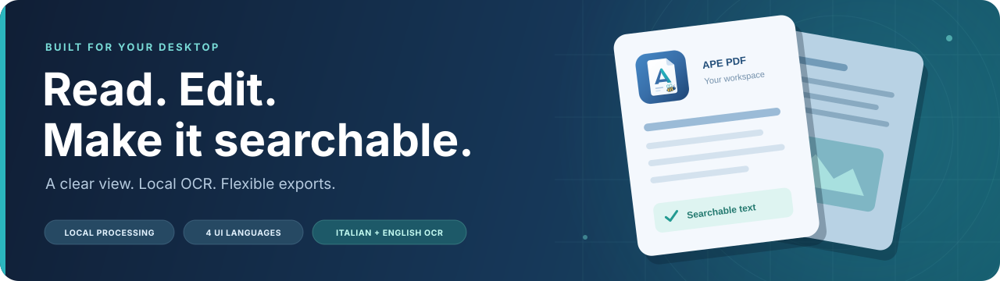
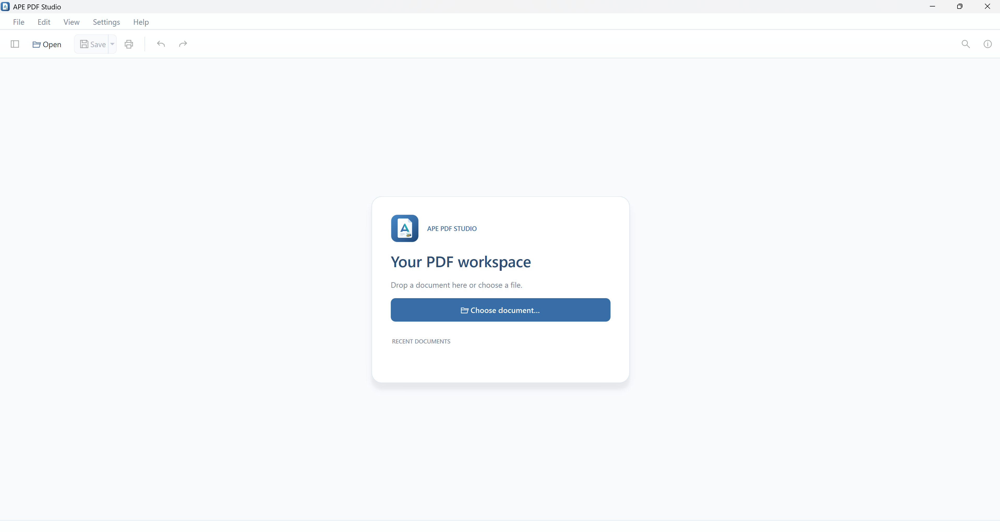
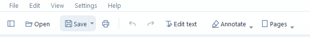
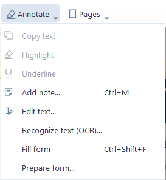
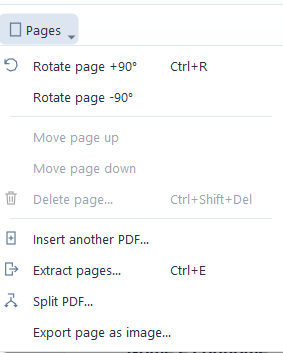

<div align="center">
  
  <h1>APE PDF Studio</h1>

  <p>A desktop PDF reader and editor with local OCR, flexible exports, and explicit saving.</p>
  <p>
    <a href="#quick-start">Quick start</a> &nbsp;·&nbsp;
    <a href="#features">Features</a> &nbsp;·&nbsp;
    <a href="#ocr">OCR</a> &nbsp;·&nbsp;
    <a href="#windows-installer">Windows installer</a> &nbsp;·&nbsp;
    <a href="#keyboard-shortcuts">Shortcuts</a>
  </p>
</div>



<p align="center">
  <strong>Windows desktop</strong> &nbsp; / &nbsp;
  <strong>Python 3.14+</strong> &nbsp; / &nbsp;
  <strong>4 interface languages</strong> &nbsp; / &nbsp;
  <strong>Local OCR</strong>
</p>

---

## Features

| A workspace for… | What you can do |
| --- | --- |
| **Reading** | Open multiple PDFs in tabs, navigate with thumbnails and bookmarks, search the whole document, and select or copy text. |
| **Editing** | Rotate, reorder, insert, delete, and extract pages; split PDFs by page, every N pages, or custom ranges; add notes, highlights, and underlines; replace supported existing text spans. |
| **PDF forms** | Fill static AcroForm text, checkboxes, radio groups and choices; save editable fields and undo or redo changes. |
| **Searchable scans** | Recognize Italian, English, or both with local OCR and an invisible text layer. |
| **Exporting** | Save pages as PNG/JPEG or convert the complete PDF to an editable Word document. |
| **Printing** | Preview paper size, scaling, margins, copies, and duplex options, or create a print-ready PDF copy. |
| **Making it yours** | Choose a color theme and an Italian, Spanish, English, or French interface. |

APE PDF Studio uses **PySide6** for the interface, **MuPDF / Qt SVG** for vector rendering, **QtPdf** for search, selection, and compatibility rendering, and **pypdf** for document edits, revisions, and saving.










## Quick start

### Windows

Run the helper from the project folder:

```powershell
.\scripts\run_windows.bat
```

It prepares `.venv-build`, the corrected MuPDF build and the native Windows sandbox, then starts the app. Source builds require **CPython 3.14.5 x64, Visual Studio C++ Build Tools and Windows SDK**. The standalone installer includes the required runtime. For manual setup:

```powershell
py -3.14 -m venv .venv-build
.\scripts\build_patched_mupdf.ps1 -PythonExe .\.venv-build\Scripts\python.exe
.\.venv-build\Scripts\python.exe -m pip install --find-links .dev-deps/patched-wheels -r requirements-release.txt -e ".[dev]"
.\scripts\build_windows_sandbox.ps1
.\.venv-build\Scripts\python.exe scripts/prepare_sandbox_runtime.py
.\.venv-build\Scripts\python.exe -m ape_pdf_studio
```

Once installed in your active Python environment, launch with `ape-pdf-studio` or `python -m ape_pdf_studio`. You can also pass a PDF directly:

```powershell
python -m ape_pdf_studio examples/sample_document.pdf
```

### macOS / Linux

```bash
bash scripts/run_mac_linux.sh
```

Alternatively, create a virtual environment, install with `python -m pip install -e .`, and run `python -m ape_pdf_studio`. Windows is the verified platform; macOS/Linux behavior and platform-specific resource limits need testing on the target system.

### First steps

1. Open one or more PDFs, or drag them into the window.
2. Use **Pages**, **Outline**, and **Search** in the sidebar to navigate.
3. Press **Ctrl+F** and type your query. The first result is selected automatically; use the arrows, **F3**, **Shift+F3**, or the result list to move between matches.
4. Drag over text or double-click a word to select it. With the PDF focused, **Ctrl+A** selects the current page's text and **Esc** clears the selection.
5. Right-click for **Copy text**, **Highlight**, or **Underline**, also available under **Annotate**.
6. Use **Save as** to write your edits. **Save** asks for a destination on the first export, then updates that working copy.

Text selection works on one page at a time; search covers the whole document. Scanned pages without a text layer need [OCR](#ocr) before their words can be searched or selected.

## Appearance and language

The interface starts in **Italian**. To switch to English on first launch, open **Impostazioni → Aspetto e lingua…**, choose **English**, and click **Applica** or **OK**. Restart the program to apply the language.

With English selected, use **Settings → Appearance and language…** or **Ctrl+,** to choose **Italiano**, **Español**, **English**, or **Français**. The preference is saved for the current user and takes effect at the next start. **Cancel** discards a selection that has not been applied.

Menus, dialogs, messages, and progress text follow the selected language. PDF text, notes, and metadata keep their contents. Interface language is independent of OCR recognition language, which supports Italian and English. The translations are included in the application and installer and work offline.

Color themes apply immediately. Choose blue, teal, sage green, graphite gray, or violet; preview a theme before applying it, or reset to the default blue.

## Checking for updates

Use **Help → Check for updates…** (**Aiuto → Verifica aggiornamenti…** in Italian). The app queries the [official GitHub latest-release API](https://docs.github.com/en/rest/releases/releases#get-the-latest-release) for `GiancaGIS/APE-PDF-Studio`, compares stable `major.minor.patch` versions numerically, and offers a button to open a newer release in your browser. Install updates manually from that page.

At every application launch, a background check starts after the window opens. When a newer stable version is available, a toast shows its version and a button to open the GitHub release. The toast stays for 15 seconds, pauses while hovered, and can be dismissed. It appears again on subsequent launches until the application is updated. Startup checks stay silent when there is no update or the request fails; the Help dialog provides detailed results and a manual retry.

Checks run asynchronously, with a 12-second deadline and a 1 MiB response limit. Startup and manual checks share the same client and do not duplicate an in-flight request. They use HTTPS with certificate validation, reject redirects, and send no PDF contents, paths, passwords, or GitHub tokens. GitHub receives the normal network request, including your IP address and the application's version in its User-Agent. A missing public release, request limit, invalid response, or connection failure is reported separately from an up-to-date result in the Help dialog. Drafts and prereleases are excluded. Tags must use `1.2.3` or `v1.2.3`, optionally with SemVer build metadata; publishing a Git tag alone does not create a release.

## Windows installer

The standalone installer includes Python, Qt, and the application dependencies. The destination PC does **not** need a Python installation.

On the build machine, install **Python x64**, **Inno Setup 6.3+**, and **Visual Studio / Build Tools** with **Desktop development with C++** and a **Windows SDK**, then run:

```powershell
.\scripts\build_installer.bat
```

| Installation mode | Permissions | Default folder |
| --- | --- | --- |
| **Current user** | No administrator rights required | `%LOCALAPPDATA%\Programs\APE PDF Studio` |
| **All users** | Administrator elevation required | `%ProgramFiles%\APE PDF Studio` |

Both modes show the license and let you choose an installation folder. The wizard creates a Start menu shortcut and optionally a desktop shortcut.

Select **Associate PDF files with APE PDF Studio** to register the application in **Open with** and **Default apps**, either for the current user or for all users. At the end of setup, you can open Windows Settings to confirm APE PDF Studio as your default PDF application. Windows 10 opens the general Default apps page; updated Windows 11 opens the application's page. The existing PDF default stays in place until you make that choice. Uninstall removes APE's registration without deleting other PDF applications' associations.

The installer also offers two independent, optional integrations for **Windows x64**:

- **PDF thumbnails:** the first page appears in File Explorer's thumbnail views.
- **PDF preview pane:** preview the document and browse pages with the arrow buttons, arrow/Page Up/Page Down keys, Home/End, or mouse wheel. The page fits the pane when it is resized.

These options work independently of the default PDF reader. Selecting them replaces the PDF providers in the selected installation scope; uninstall restores the previous registrations if APE still owns those slots. Providers selected by other applications after APE are preserved. No Explorer display preferences are changed: enable thumbnail views and the preview pane (**Alt+P**) in File Explorer if needed. Close and reopen Explorer after installation; a restart may be required if Windows has the DLL loaded during an update or uninstall.

Rendering uses an isolated helper with a 15-second deadline and a 768 MiB memory limit. Password-protected, malformed, oversized, or policy-blocked PDFs fall back to an icon or an unavailable-preview message. The preview does not run PDF actions or open links. The native shell handlers are x64 only and are not installed on Windows ARM64.

Build output:

```text
dist/APEPDFStudio/                         Application, worker and shell DLL
dist/installer/APEPDFStudio-<version>-Setup-x64.exe
build/windows/smoke-report.json            Compiled application checks
```

Distribute the complete standalone folder, including `APEPDFStudio.exe`, `APEPDFWorker.exe`, `ape-pdf-cli.exe`, `APEPDFShell.dll`, `_internal/`, `licenses/` and the legal documents. Provide the matching source archives with it. The installer targets Windows x64, Windows 10 1809 or later. See the [full Windows installer guide (Italian)](docs/windows-installer.md) for build options, custom licenses, silent installation, and release checks.

The application icon is included in the window, executables, installer, and shortcuts. Its editable source is [`app-icon.svg`](src/ape_pdf_studio/assets/app-icon.svg). After changing it, regenerate the PNG and ICO before building:

```powershell
.\.venv\Scripts\python.exe .\scripts\generate_app_icon.py
```

## Page organization and editing

- Click the page number, enter a destination, and press **Enter**. Leaving the field also confirms it; **Esc** cancels the typed value.
- Rotate pages by ±90° from **Pages**, **Edit**, or the thumbnail context menu.
- Delete a page with confirmation while keeping at least one page in the document.
- Move a page up or down one position from **Edit**.
- Insert another PDF after the current page.
- Add text notes, highlight selected text, or underline it.
- Use **Edit text → Paragraph reflow** to edit a recognized paragraph and wrap words within its column. Disable reflow to edit a single span. Font substitution can change its appearance; scans require OCR.
- Extract ranges such as `1,3-5`.
- Export the current page as an image from **Pages**, **File → Export**, or its thumbnail context menu.
- Undo and redo page edits and annotations.

## OCR

Open a scanned PDF and choose **Edit → Recognize text (OCR)…** or **Annotate → Recognize text (OCR)…**.

| Option | Choices |
| --- | --- |
| **Recognition language** | Italian, English, or Italian and English (default) |
| **Pages** | All pages, current page, or a range such as `1,3-5` |
| **Resolution** | 300 dpi for quality; 150 dpi for speed |

OCR adds an **invisible, searchable, selectable, and copyable text layer**. It keeps the original page image, dimensions, rotations, crop boxes, notes, links, attachments, bookmarks, and metadata. Pages already containing text are skipped, including pages that also contain a scan; existing OCR is not overwritten.

Recognition runs locally with PyMuPDF's integrated OCR engine. On first use, **Download missing language data on first use** downloads up to **7 MB** of models from the official [Tesseract tessdata_fast project](https://github.com/tesseract-ocr/tessdata_fast/tree/4.1.0), verifies their SHA-256 hashes, and stores them in the application data folder. Only models are downloaded; your PDF is not uploaded. OCR works offline after that download. The models are distributed under Apache-2.0.

On Windows, downloaded models are stored in `%LOCALAPPDATA%\GiancaGIS\APE PDF Studio\ocr\tessdata`: `ita.traineddata` for Italian and `eng.traineddata` for English.

To use existing models, set `TESSDATA_PREFIX` to a folder containing `ita.traineddata` and/or `eng.traineddata` before starting the app. Standard Tesseract folders on Windows, macOS, and Linux are also checked. If models are missing and downloads are disabled, the app reports an error and leaves the document unchanged. No additional Python dependency is needed: [PyMuPDF includes integrated OCR support](https://pymupdf.readthedocs.io/en/latest/installation.html#enabling-integrated-ocr-support).

The worker provides progress and **Cancel**, a memory limit where supported, a three-minute limit per page, and working images of up to 16 megapixels. Resolution is reduced for large pages and reported afterward. Complete or cancel OCR before closing the affected tab or the application.

Results are applied only after the entire operation succeeds, as **one undoable edit**. Use **Ctrl+Z** to undo, **Ctrl+Y** to redo, and **Save** or **Save as** to keep the recognized text. Errors and cancellation do not apply partial results. Protected PDFs remain read-only; signature and PDF/A notices behave as they do for other edits.

Recognition quality depends on scan clarity and orientation. Blank pages and pages with no recognized words are reported in the summary. OCR does not automatically deskew or rotate scans and does not rebuild a Word-style layout.

## Exporting images and Word documents

### Page images

**Export page as image** offers PNG/JPEG format and resolution choices. It exports the selected page at its PDF dimensions, independent of zoom, with a white background and annotations. Images exceeding **40 megapixels** require a lower resolution.

### Word documents

**File → Export → Export entire PDF to Word** converts every page of the current revision, including unsaved changes. Extracted text stays editable; pages without text are included as images, without OCR. Microsoft Word and online conversion services are not required.

Word layout is reconstructed. Check the result, especially for columns, tables, and complex documents. Interactive forms and digital signatures do not become equivalent Word objects. Pages exceeding Word's **55.8 cm** dimension limit are rejected with a message. Cancellation and errors preserve a pre-existing destination file. Exports leave the PDF unchanged and do not mark its edits as saved.

## Printing

Choose **File → Print…**, click the printer button, or press **Ctrl+P / ⌘P**. APE's print dialog places options on the left and a sheet preview on the right. Physical printing uses the installed system drivers.

- Select a printer, supported paper size, orientation, color mode, and duplex mode according to the driver's reported capabilities. Duplex is disabled when unsupported.
- Print all pages, the current page, a custom range, or the current view. Filter odd/even pages, reverse order, set copies, and collate. Preview navigation follows the actual copy order.
- Fit to margins, shrink oversized pages, print at actual size, or set a custom scale from **10% to 1000%**. Auto-rotate and center content; effective scale and paper size are shown below the preview. The dashed margin border is a guide and is not printed.
- Include printable PDF annotations, or exclude comments while retaining form fields. Vector printing is preferred where supported; complex images and effects use compatibility rendering. **Print as images** explicitly rasterizes at 150, 300, or 600 dpi. Large sheets are rasterized only where they intersect the paper, in tiles of up to 1024 × 1024 pixels.
- **Save to PDF** creates a print-ready copy using the chosen size and scale, including unsaved edits. It does not change the open document or mark it as saved. Replacing an existing file requires confirmation; cancellation and errors preserve it.
- Progress, interruption, and completion notifications are provided. For a physical printer, completion confirms delivery to the driver, not that the pages have left the printer. Interruption cannot withdraw sheets already in the print queue.

The print copy is a rendered document. It does not retain digital signatures, PDF/A identification, links, or searchable text from vector paths. Use **Save / Save as** to retain the PDF's document structures. **Current view** refers to the visible part of the selected page, not an entire multipage viewport. Ignoring margins changes positioning but cannot remove the printer's physical limits. Physical printing and macOS behavior need testing on the target device; automated checks use PDF output only.

## Saving, metadata, and document validity

### Saving and working copies

The original stays unchanged while you edit. Private copies and revisions live in a temporary folder until the tab closes.

**Save as** can target the original file, but overwriting requires confirmation and history retains the previous revision. Writes use a temporary file in the destination folder followed by `os.replace`. You cannot export over a file belonging to another open tab, or extract pages over the current document.

**Split PDF** is available from **File** and **Pages**. Choose one file per page, every N pages (including the final shorter group), or custom groups such as `1-3; 4,6; 5,7-10`. Custom groups must include every page exactly once. Preview the files and select a destination folder: the current revision, including applied form values and edits, is exported into a new `PDF_split` subfolder with numbered files. Existing folders receive a numeric suffix; existing PDFs are never overwritten. Cancellation or a failed export removes the files created by that split. The original document and its undo history remain intact. PDF parsing continues in the isolated worker, and Windows Internet provenance is retained.

**Insert blank page** is available under **Pages**, **Edit**, and the thumbnail context menu. Insert before or after any page, using that page's displayed dimensions or A4 portrait/landscape. The new page becomes the current page. Forms, bookmarks and metadata are retained; insertion supports undo/redo.

**Add watermark** under **Pages**, **Annotate** or **Edit** adds centered text to every page, including scanned pages. Choose text, color, size, opacity and rotation; long text scales to fit. The preview is illustrative. The watermark becomes static page content and can be undone during the editing session. PDF processing and validation run in the sandbox while the interface remains responsive.

**Draw** activates a pen directly on the page. Choose color, thickness in points and opacity from its toolbar. Strokes appear immediately as smooth vectors; pointer motion does not wait for PDF operations. Undo/redo works on individual draft strokes. **Select drawings** and **Delete drawing** (or the Delete key) remove a stroke. **Done**, saving, or another document edit commits the drafts as standard, printable PDF Ink annotations. Saved strokes remain selectable and removable after reopening, including Ink annotations from other viewers. Existing flattened drawings and scanned handwriting are page content and cannot be selected as Ink. Encrypted documents remain read-only. Selection of unusually complex annotations is bounded (2000 annotations / 20000 points per revision); a notice reports when some drawings cannot be selected. They remain rendered and preserved. Each gesture accepts up to 8000 sampled points, and draft batches are bounded; revision history supports undo after commit.

**Edit text** activates direct editing on the PDF page. **Paragraph reflow** is enabled by default: click a recognized text box and edit multiple lines in place. Words wrap using PDF font metrics within the original column width, and the paragraph can grow into free space below. The editor supports explicit line breaks, first-line/continuation indents, left/center/right/justified alignment and retained inline font, size and RGB style runs. New text inherits a nearby source style; unavailable fonts use a compatible fallback. Enter inserts a line break; Ctrl+Enter applies. Escape discards a draft, and a second Escape exits the mode. Ctrl+S commits a valid draft before saving. Disable reflow for the previous single-span workflow, where Enter applies.

Paragraph recognition is geometric and conservative: native text blocks, different columns, large gaps, headings and list items remain separate. Growth stops before other text, graphics, widgets, containing backgrounds or the page boundary. Overflow keeps the draft open and leaves the PDF revision unchanged; it never silently shrinks, clips or spills text onto another page. Editing supports horizontal text and simple writing systems, up to 16000 characters and 32 font/style combinations per paragraph. The editing field uses locally available screen fonts; the PDF's fonts and the worker's metrics determine the saved layout. Fields follow zoom and scrolling, drafts stay with their tab, and applied edits support undo/redo. Parsing, layout and font inspection stay in the sandbox; catalog data, other pages, forms, links, metadata and attachments remain preserved. This is paragraph-local reflow, matching the scope [described by Adobe](https://helpx.adobe.com/acrobat/using/edit-text-pdfs1.html), rather than whole-document repagination. Scans require OCR. Try [the paragraph example](examples/riflusso_paragrafi.pdf), generated by `scripts/generate_paragraph_example.py`.

Closing an edited document offers **Save**, **Discard**, and **Cancel**. Temporary revisions are not retained after closing. Encrypted PDFs are opened read-only; editing and export are disabled. The app requests a password only when one is required to read the document. PDFs protected only against modification (an owner password with an empty opening/user password) open directly without a password prompt and retain their protection.

### Metadata

Open **Document properties → Metadata**, edit fields, and select **Apply changes**. This updates the working copy; use **Save** or **Save as** to keep it. Closing the panel without applying discards the entered values. Leave a field empty to remove it; separate multiple authors with `;`.

Edited fields are updated in the Info dictionary and any existing XMP package. Title and subject translations, additional XMP fields, and PDF/A identification are preserved unless the relevant field is explicitly removed. When Info and XMP differ, the panel reports it and shows Info values; only edited fields are synchronized. Without XMP, changes stay in the Info dictionary.

Dates, producer information, and technical or custom fields are read-only in **Document**. **XMP** shows the complete XML package. Protected PDFs and unreadable XMP metadata can be inspected but not modified. Metadata edits can also invalidate signatures and require PDF/A compliance to be checked again.

### Digital signatures and PDF/A

A banner appears when the original contains signature data or a recognized PDF/A declaration. **File → Document properties** (**Ctrl+I**) and **Details** show the declared PDF/A level and each signature's field, signer, date, and reason. Empty signature fields are distinguished from populated ones.

Detection does **not** validate certificates, cryptographic integrity, or timestamps. PDF/A identification comes from XMP and does **not** certify compliance; use a dedicated validator such as [veraPDF](https://docs.verapdf.org/validation/). The banner therefore distinguishes declared standards from unverified validity.

After edits, the banner notes that signatures and declarations belong to the original and that compliance needs rechecking, even after saving. Undoing all changes restores the original notice. Page reconstruction can affect internal links, bookmarks, forms, and other complex structures; edits invalidate digital signatures. Use working copies for critical documents. Digital signing and secure redaction are not included.

## Fillable PDF forms

### Prepare a form from a flat PDF

Use **Annotate → Prepare form…** or **Edit → Prepare form…** (**Annota → Prepara modulo…** in Italian). A review panel opens beside the page. Enter the pages to analyze (for example `1,3-5`, at most 50 per operation), then select **Detect fields**. The detector suggests text fields and checkboxes using empty rectangles, underlines and nearby text. Scanned pages also use bounded image analysis. Optional local OCR reads labels with already installed Italian/English models; no document is uploaded and this feature does not download models. Without models, geometric detection still works and fields receive editable generic names.

Suggestions are highlighted directly on the page. Select a box to edit its unique name, label, type, multiline setting and dimensions. Drag a box to move it, or drag its lower-right handle to resize it. Choose **Draw text field** or **Draw checkbox** and drag on the page to add a missed field. Delete a suggestion with the panel button or **Delete** while the page is focused. **Esc** cancels an unfinished drawing. Blank table cells and decorative boxes can be false positives: review every suggestion.

Select **Create fields…** and confirm to create standard, script-free AcroForm fields as one undoable edit. Close preparation, fill fields directly on the page, then **Save / Save as**. Closing preparation with uncreated suggestions asks whether to discard them. Existing fields and values, metadata and document structures are preserved; duplicate names, substantially overlapping boxes and stale revisions are rejected. Protected PDFs retain the read-only policy. Detection suggests text fields and checkboxes; choices can be configured manually. Radio groups and automatic calculations are not inferred.

Try the flat [digital example](examples/modulo_da_preparare.pdf) and [scanned example](examples/modulo_da_preparare_scansione.pdf). Both intentionally start without interactive fields and can be regenerated with `python scripts/generate_form_preparation_example.py`.

Analysis runs in a separate, cancellable worker with a 90-second deadline and a mandatory 768 MiB process memory limit. On Windows it uses AppContainer without network access. Raster analysis is limited to 4 million pixels per page, and the result protocol is bounded to 2 MB. Suggestions alone do not modify the PDF; creation uses the existing checked revision and atomic save workflow.

### Modify existing fields

Open **Annotate → Prepare form…** to select an existing field directly on the page or in the panel. Change its type to **Text**, **Checkbox**, **Dropdown** or **Choice list**; edit its name, label, multiline, required/read-only settings and geometry. For choices, enter one option per line, either `value` or `value | display label`. Existing export values and labels are retained unless edited. Radio groups already present can retain their type or be converted to another supported type; creating new radio groups is not supported. Signature fields and action buttons are excluded, and encrypted documents remain read-only.

Repeated widgets share a field: changes to name, type and other properties apply to every instance, while movement and resizing affect the selected widget. Rename only the final component of a hierarchical name. **Delete field** removes all its instances. **Apply changes…** previews an explicit confirmation and commits editing, deletion and additions as one undoable operation. Changing type resets the field's current and default values; removing choice options drops selections that are no longer valid. Unrelated values and document structures are retained. Close preparation to fill the revised form on the page, then **Save / Save as**. Closing with pending edits asks whether to discard them.

### Fill existing forms

Open [`examples/modulo_compilabile.pdf`](examples/modulo_compilabile.pdf) to try text fields, multiline notes, a checkbox, a radio group, a dropdown, multiple selections and a read-only reference. It also includes two explicit links for testing the permission dialogs. Generate it again with `python scripts/generate_form_example.py`; the sample contains no scripts or automatic submission.

Click a highlighted field and fill it **directly on the PDF page**. Checkboxes and individual radio buttons respond to clicks; text, choices and lists use controls positioned inside the field. **Fill form** in the banner or **Edit** menu, or **Ctrl+Shift+F** (**Compila modulo** in Italian), focuses the first available field. **Tab / Shift+Tab** move between fields, including those on other pages. **Enter** confirms a single-line field; **Ctrl+Enter** confirms multiline notes. **Esc** discards the active field's pending changes.

Leaving a field applies its value to the working copy as one undoable change. Use **Save / Save as** to write the PDF; saving also includes the currently focused field, and fields remain editable in compatible readers. Controls follow zoom, scrolling and viewport size. Invalid values or write failures retain the draft and prevent saving or closing until corrected or cancelled with Esc. **Ctrl+Z / Ctrl+Y** undo and redo applied field values; the original is preserved until you explicitly overwrite it.

This supports static **AcroForm** fields, with a limit of 500 fields and 32,768 characters per value, subject to each field's own text limit. Field names may be hierarchical; repeated widgets share their value. Required-field flags are retained, and partial forms may still be saved. Read-only fields, signature fields and action buttons cannot be edited. Encrypted PDFs retain the application's existing read-only policy. XFA, JavaScript calculations/validation and automatic submission remain unsupported and subject to the preventive security check. Editing a signed or PDF/A-declared document can invalidate signatures or compliance. Page reconstruction can affect complex form structures; inspect the saved working copy after page edits.

Implementation follows the [pypdf form API](https://pypdf.readthedocs.io/en/stable/user/forms.html), preserving AcroForm structures and generating field appearances with `auto_regenerate=False`.

## Security checks and resource limits

The preventive check is always enabled, including in the CLI. The broker creates a size-bounded private snapshot; the isolated worker checks those same bytes before rendering or editing them. The main process does not interpret the PDF. Passwords are sent through standard input and do not appear in command-line arguments. Source workers ignore `PYTHONPATH` and the current directory when importing modules; compiled workers use their bundled code.

Structural analysis visits the catalog, pages, annotations, forms, references, and xref objects, including compressed objects. It does not execute JavaScript, PDF actions, or attachments. Embedded JavaScript alone does not block opening: the document banner reports that script execution is disabled. MuPDF documents explicitly disable their JavaScript runtime, and disposable Qt rendering/print copies remove script actions and JavaScript name trees before loading. Script-based form calculations, validation and buttons are unsupported. Script definitions remain in original and saved editable PDFs; another viewer applies its own execution policy. APE does not modify the original or enable scripts through its link confirmation controls.

Other blocked findings, including file/program launch, external data submission/import, unsupported actions, XFA and active multimedia, still prevent opening. A blocked file contains unsupported content or failed a check; **blocking does not prove the presence of malware**.

User-selected cloud and Personal Vault paths retain their accessible Windows spelling instead of being replaced by internal volume paths. The broker copies only the selected PDF into its private session; the sandbox receives no access to the source folder. File identity checks still prevent exporting over another open document through an alias. The Vault must be unlocked and the selected file accessible to Windows.

Generated edit revisions are checked before entering the undo history or renderer. This also enforces the page limit on merged documents. Stream checks inspect the stored bytes as well as any declared length; pypdf removes the `/Length` key during parsing. See the [security review](docs/security-review.md) for verification scope, dependency findings, and remaining risks.

Embedded attachments are reported and cannot be opened. HTTP/HTTPS/email links start disabled: use **Enable links…** in the document banner, or click an explicit link and confirm enabling it for that tab. Each opening then shows the exact destination and asks for confirmation, with **No** selected by default. Permission expires when the tab closes, does not affect other documents, and can be revoked with **Disable links**. Only explicit link annotations are handled. PDFs containing file:// or relative links can open for reading; a banner reports those links as disabled. Such links are excluded from all user activation paths and stripped from disposable PDFium display/print copies. Original files and editable saved revisions retain their links. Automatic actions and scripts are never executed; file/program launch actions, custom-protocol actions and form submission still block opening. The app rejects malformed addresses, credentials in web URLs, and email attachment parameters. Your browser or email application may contact external services after confirmation. PDF data is never automatically submitted.

Attachments may remain in saved PDFs; they are not stripped or disinfected. Signed, PDF/A-declared, and encrypted documents must also pass the check. Encrypted PDFs are checked after successful authentication, using an empty password when the document permits opening without one.

<details>
<summary><strong>Input limits and rendering budgets</strong></summary>

| Check | Limit |
| --- | --- |
| Input file | 256 MiB |
| Page count | 3,000 |
| Page dimensions | Up to 200 inches |
| PDF objects | 100,000 |
| Object visits / nesting depth | 2,000,000 / 64 |
| Security check duration | 12 seconds |
| Streams and decompression | 32 MiB |
| XMP input | 1 MB |
| Each worker memory | 768 MiB; operation blocked if the limit cannot be applied |

The [pypdf configuration limits](https://pypdf.readthedocs.io/en/latest/modules/configuration.html) bound stream decompression and XMP processing. The worker uses a Windows Job Object or `RLIMIT_AS` where supported; **Security** reports whether its memory limit was applied.

Vector rendering retains up to three validated drawing lists, limited to 12 MiB each, with bounded paths, numeric transforms, clips and solid colors. PDF-derived SVG is interpreted only inside the worker. Compatibility rendering uses tiles of up to 1024 × 1024 pixels, a 64 MiB cache, and at most two pending requests. Resolution follows zoom and display pixel ratio; exceptionally large viewports limit the visible raster plan to 12 megapixels.

</details>

**On Windows, PDF processing uses AppContainer.** Rendering, search, editing, forms, printing preparation and conversions run in workers without network capabilities or child processes, with access to their own private workspace and approved code. The GUI receives validated pixels, drawing commands and typed data. Explorer's adapter acts as a medium-integrity broker for its AppContainer child; low-integrity hosts that cannot create the sandbox fail closed. This changes APE's preview-host registration and requires the updated installer.

This is not antivirus software or a guarantee against unknown exploits. Memory limits apply per worker; disk quotas are preventive/periodic checks. Private session cleanup and Windows Internet-zone propagation protect temporary and derived files. The build includes pypdf 6.21.2 (fixing [CVE-2026-113786](https://github.com/py-pdf/pypdf/security/advisories/GHSA-5hx5-vpf9-5wcv)) and native MuPDF 1.28.5. Other platforms do not receive the Windows OS sandbox. See [security architecture, dependency recipe, test limits and signing procedure](docs/security-hardening.md). Signed releases require a code-signing certificate; development builds remain unsigned.

## Keyboard shortcuts

| Shortcut | Action |
| --- | --- |
| `Ctrl+O` | Open PDF |
| `Ctrl+W` | Close tab |
| `Ctrl+S` | Save |
| `Ctrl+Shift+S` | Save as |
| `Ctrl+F` | Find text |
| `F3` / `Shift+F3` | Next / previous result |
| `Ctrl+C` | Copy selected PDF text |
| `Ctrl+A` | Select page text, when the PDF is focused |
| `Esc` | Clear PDF selection |
| `PgUp` / `PgDown` | Previous / next page |
| `Ctrl++` / `Ctrl+-` | Zoom in / out |
| `Ctrl + wheel` / `⌘ + wheel` on macOS | Zoom around the pointer |
| `Ctrl+I` | Document properties, signatures, and PDF/A identification |
| `Ctrl+,` / `⌘+,` on macOS | Appearance and language settings |
| `Ctrl+R` | Rotate page +90° |
| `Ctrl+Shift+Delete` | Delete page with confirmation |
| `Ctrl+M` | Add note |
| `Ctrl+E` | Extract pages |
| `Ctrl+Z` / `Ctrl+Y` | Undo / redo |

Page deletion uses **Ctrl+Shift+Delete**, leaving the regular **Delete** key available in text fields.

## Command-line interface

```powershell
ape-pdf-cli examples/sample_document.pdf info
ape-pdf-cli examples/sample_document.pdf rotate 1 -o rotated.pdf
ape-pdf-cli examples/sample_document.pdf extract "1,3-4" -o selection.pdf
ape-pdf-cli examples/sample_document.pdf note 1 "Review this page" -o with_note.pdf
```

The PDF engine does not import Qt and can be used independently of the interface.

The current product and launcher names are **APE PDF Studio**, `ape-pdf-studio`, `ape-pdf-cli`, and `python -m ape_pdf_studio`. The application package is `ape_pdf_studio`.
The rename preserves saved settings, recent documents, and previously downloaded OCR models.

## Development and verification

```powershell
python -m pip install -e ".[dev]"
python -m pytest -q
```

The suite covers the PDF engine, CLI, and real Qt interactions: search, mouse/keyboard selection, clipboard, context menus, annotations on rotated/cropped pages, long-document thumbnails, and tiled rendering compared with full-page output. It also checks HiDPI and rapid zoom, stale-image removal, wheel zoom, page navigation during updates, themes and persistent preferences, active-content blocking (including encrypted and compressed content), scanner failures, destination protection, and security notices.

Document tests cover PDF/A metadata and signature structures, Info/XMP synchronization with preservation of translations/attachments/bookmarks, saving, undo/redo, closing, PNG/JPEG export, and DOCX conversion with scans, blank pages, and cancellation. Signature fixtures are synthetic detection structures without cryptographic validity. GUI tests require PySide6 and use Qt's `offscreen` platform and isolated preferences.

This version has been checked on **Windows with Python 3.14, PySide6 6.12.0, pypdf 6.21.2, and pdf2docx 0.5.13**. Automated visual checks do not replace testing on your own display and documents.

OCR tests include real bilingual scans, visual and structural preservation, rotations/crops/UserUnit, Qt search and clipboard, saving and undo/redo, worker cancellation, and download verification. Set `TESSDATA_PREFIX` to Italian and English models or place them in `.dev-deps/tessdata/` to enable actual recognition tests. Those tests are skipped if the models are missing and never download models from the network.

### Project layout

```text
src/
  ape_pdf_studio/          Application package and module launcher
    app.py                Application entry point
    assets/               Editable app icon: SVG, PNG, and Windows ICO
    locales/              English, Spanish, and French message catalogs
    core/
      editor.py           Revisions, annotations, and atomic saving
      ocr.py              Local OCR and invisible text layers
      document_info.py    PDF/A identification and signature data detection
      metadata.py         Metadata inspection and Info/XMP synchronization
      security.py         Input policy and preventive structural analysis
      security_worker.py  Security worker with resource limits
      worker_process.py   Source and compiled worker commands
      worker_entry.py     Compiled worker dispatch
      vector_page.py      Static SVG display lists and vector clipping
      vector_worker.py    Vector page preparation in a separate process
      docx_export.py      Local PDF-to-Word conversion and atomic writing
      print_source.py     Private print snapshot
      cli.py              Commands without Qt
      localization.py     Translated messages without Qt dependencies
    ui/
      main_window.py      Commands, tabs, opening, and saving
      document_tab.py     Navigation, search, thumbnails, and outline
      pdf_view.py         Selection, clipboard, and asynchronous rendering
      page_tiles.py       Visible-tile rendering at the current zoom
      vector_pages.py     Vector cache and direct viewport drawing
      thumbnails.py       Asynchronous thumbnails for visible pages
      document_notice.py  Original-document notices and properties
      properties_dialog.py  Document properties and metadata editing
      content_dialogs.py  Note and text-edit dialogs
      settings_dialog.py  Theme and interface language selection
      language.py         Language setup and Qt translations
      page_number.py      Page number input and confirmation
      exports.py          PNG/JPEG rendering and Word export worker
      ocr.py              OCR options and cancellable worker
      printing.py         Print rendering and cancellable jobs
      print_dialog.py     Print settings and preview
      icons.py            Application and vector toolbar icons
      theme.py            Shared interface themes
scripts/                  Launchers, icon generation, build, and smoke checks
installer/                PyInstaller specification and Inno Setup script
docs/assets/              README cover artwork
```

## References and licenses

**APE PDF Studio is licensed under GNU AGPLv3 only**, copyright © 2026
**GiancaGIS**. You may use, modify and redistribute it under the terms of the
[full license](LICENSE), including the applicable source-sharing obligations.
Third-party libraries retain their own licenses; see
[third-party notices](THIRD_PARTY_NOTICES.md) and [copyright notices](NOTICE).

Windows releases include full license texts and an inventory of their exact
dependencies. Open **Help → Licenses and source code** to read them in the app.
Each installer release must include its matching application and dependency
source archives, with SHA-256 checksums, at the same download location.
See [source and rebuild instructions](SOURCE_CODE.md) and the
[GitHub release guide](docs/github-release.md).

- [QtPdf](https://doc.qt.io/qtforpython-6/PySide6/QtPdf/index.html)
- [QPdfView](https://doc.qt.io/qtforpython-6/PySide6/QtPdfWidgets/QPdfView.html)
- [pypdf](https://pypdf.readthedocs.io/)
- [pdf2docx](https://pdf2docx.readthedocs.io/en/latest/quickstart.convert.html)
- [python-docx](https://python-docx.readthedocs.io/)
- [PyMuPDF](https://pymupdf.readthedocs.io/)
- [Project license](LICENSE)


## Disclaimer

The software is distributed on an "AS IS" BASIS, WITHOUT WARRANTIES OR CONDITIONS OF ANY KIND, either express or implied.
